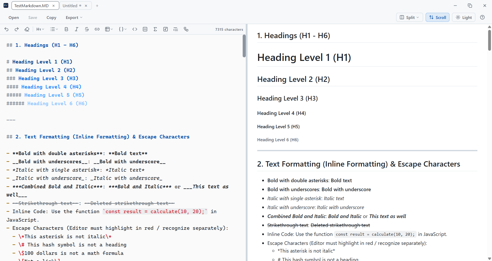
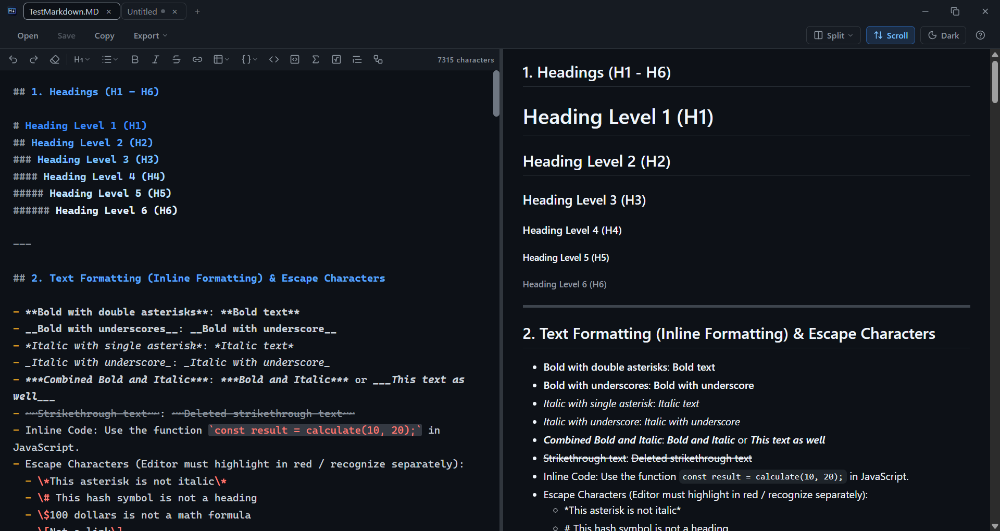

<div align="center">


# Markdown Live

A standalone, offline-first, real-time bidirectional Markdown editor packaged on the Tauri v2 platform.

[](https://tauri.app/)

[](https://developer.mozilla.org/)
[](https://github.com/uytran0610/markdown-live-app/releases)
[](LICENSE)

</div>

<div align="center">

**English** | [Tiếng Việt](README.vi.md)

</div>

---

## Table of Contents

- [Technical Features](#technical-features)
- [Screenshots](#screenshots)
- [Quick Start](#quick-start)
- [How to Use](#how-to-use)
- [Export Guide](#export-guide)
- [Architecture Overview](#architecture-overview)
- [Tech Stack](#tech-stack)
- [Project Structure](#project-structure)
- [Contributing](#contributing)
- [License](#license)

---

## Technical Features

- **Dual-Pane Bidirectional Sync & Three View Modes:** Real-time side-by-side editing with near-zero latency; switch instantly between **Editor**, **Split**, and **Preview**, or drag the divider to resize panes freely.
- **Rich Rendering, Fully Offline:** GitHub Markdown Alerts, KaTeX math (inline and block), Mermaid diagrams, and Highlight.js syntax highlighting — all rendered locally.
- **Full Editing Toolkit:** A formatting toolbar (headings, lists, bold/italic, tables, links, code, math, Mermaid snippets), live Markdown syntax highlighting, and a real-time character counter.
- **Multi-Format Export:** Standalone HTML (`.html`), Word (`.doc`, with Mermaid diagrams converted to images), or vector PDF (selectable text).
- **Tabs & Data Safety:** Open multiple files as tabs; drafts, tab order, and your last view mode are auto-saved and restored on the next launch.
- **Light/Dark Theme:** Automatic system theme detection with manual override, persisted between sessions.

---

## Screenshots





---

## Quick Start

### Download Pre-built Binary (Recommended for users)

A portable Windows executable (`.exe`) is automatically built via GitHub Actions for every release tag. Download the latest release from the **[Releases](https://github.com/uytran0610/markdown-live-app/releases)** page—no installation required, just launch `Markdown-Live-Portable.exe`.

> [!WARNING]
> **Windows SmartScreen may flag the app on first launch**
>
> Because this is a free, open-source project that is **not digitally signed** with an expensive code-signing certificate, Windows Defender SmartScreen may display a **"Windows protected your PC"** warning when you run the file for the first time, showing **Publisher: Unknown publisher**. This is standard behavior for unsigned software and does not mean the file contains malware. You can choose **either** of the two methods below to proceed.

**Bypass SmartScreen prompt**

1. In the **"Windows protected your PC"** dialog, click **More info** if the **Run anyway** button is hidden.
2. Click **Run anyway** to launch the application.

**Unblock the file (If double-clicking fails to open the app)**

1. Right-click `Markdown-Live-Portable.exe` → select **Properties**.
2. Under the **General** tab, scroll down to the bottom **Security** section. Look for the message: *"This file came from another computer and might be blocked to help protect this computer."*
3. Check the **Unblock** box → click **Apply** → **OK**.
4. Double-click the `.exe` file again; the app will now launch normally.

> [!NOTE]
> If you want to verify the file before execution, you can scan it using your preferred antivirus software or upload it to [VirusTotal](https://www.virustotal.com/) to compare results across multiple security engines.

### Build from Source (For developers)

**Prerequisites:**
- [Node.js](https://nodejs.org/) v20 or later
- [Rust toolchain](https://www.rust-lang.org/tools/install) (latest stable)
- Tauri v2 system prerequisites as outlined in the [Tauri Prerequisites Guide](https://tauri.app/start/prerequisites/)

**Steps:**

```bash
# 1. Clone the repository
git clone https://github.com/uytran0610/markdown-live-app.git
cd markdown-live-app

# 2. Install dependencies
npm install

# 3. Run in development mode (dev, hot-reload)
npm run tauri dev

# 4. Build release package (NSIS/MSI installer)
npm run tauri build
```

---

## How to Use

After launching the application, type or paste your Markdown content into the **EDITOR** pane on the left; the output will be rendered instantly in the **PREVIEW** pane on the right. The top toolbar provides convenient actions:

| Action | Description |
| :--- | :--- |
| **Open** | Open one or more Markdown files from your device; each opens as its own tab — a file that is already open is focused instead (`Ctrl`/`Cmd` + `O`) |
| **Recent** | Menu of recently opened files with **Clear Recent Files** at the bottom (appears only after you have opened a file) |
| **Save** | Write the current tab back to its file on disk, or prompt for a location if the tab has no file yet (disabled until that tab has unsaved edits) (`Ctrl`/`Cmd` + `S`) |
| **Save As** | Save the current tab under a new name or location (`Ctrl`/`Cmd` + `Shift` + `S`) |
| **Save All** | Save every tab that has unsaved edits, one after another (`Ctrl`/`Cmd` + `Alt` + `S`); appears only when two or more tabs are changed |
| **Copy** | Copy the full raw Markdown content of the current tab to the clipboard |
| **Export** | Open a menu to export content as **HTML** (`.html`), **Word** (`.doc`, Mermaid diagrams are converted to images), or **Print** (`.pdf` via the system print dialog, selectable text) |
| **View** | Switch between **Editor**, **Split**, and **Preview** modes |
| **Scroll** | Toggle synchronized scrolling between Editor and Preview (on by default) |
| **Theme** | Toggle between Light and Dark themes |
| **About** | Open the About dialog — app version, License and Third-party Notices (the round `?` button at the far right) |

### View Modes & Resizing Panes

- **Editor** — full-width editing with no live preview.
- **Split** — Editor and Preview side by side (default).
- **Preview** — full-width rendered output only.

In **Split** mode, drag the vertical divider between the two panes to resize them freely; dragging it all the way to either edge switches to **Editor** or **Preview** automatically. The app remembers your last-used view mode between sessions (the pane width itself is not saved and always reopens at 50/50).

### Formatting Toolbar

The formatting toolbar sits above the **EDITOR** pane. Select some text and click a button to apply the formatting, or click without a selection to insert the Markdown syntax at the cursor position.

| Button | Description | Markdown Output | Shortcut |
| :--- | :--- | :--- | :--- |
| **Undo** / **Redo** | Step backward or forward through your edit history | — | `Ctrl`/`Cmd` + `Z` / `Ctrl`/`Cmd` + `Y` |
| **Clear** | Empty the entire editor (confirmation required) | — | — |
| **Headings** | Choose a heading level from the list | `# Heading 1` ... `###### Heading 6` | — |
| **Lists** | Choose a list type: bullet, numbered, or task list | `- item`, `1. item`, `- [ ] task` | — |
| **B** (Bold) | Make the selected text bold | `**text**` | `Ctrl`/`Cmd` + `B` |
| *I* (Italic) | Make the selected text italic | `*text*` | `Ctrl`/`Cmd` + `I` |
| ~~S~~ (Strikethrough) | Strike through the selected text | `~~text~~` | `Ctrl`/`Cmd` + `Shift` + `X` |
| **Link** | Opens a dialog to enter display text and a URL, then inserts the link | `[text](url)` | — |
| **Table** | Pick dimensions on a visual 5×5 grid, or choose **Custom size** for larger tables | `\| Column \| Column \|` | — |
| **HTML Inline** | Wrap the selection in Superscript, Subscript, `<kbd>` (keyboard key), or `<mark>` (highlight) | `<sup>`, `<sub>`, `<kbd>`, `<mark>` | — |
| **Inline Code** | Wrap the selection as inline code | `` `code` `` | `Ctrl`/`Cmd` + `E` |
| **Code Block** | Insert a fenced code block | ` ```js ... ``` ` | — |
| **Inline Math** | Wrap the selection as inline LaTeX | `$E = mc^2$` | — |
| **Math Block** | Insert a LaTeX display block | `$$ ... $$` | — |
| **Blockquote** | Turn the current line(s) into a blockquote | `> text` | — |
| **Mermaid Diagram** | Insert a starter Mermaid diagram block | ` ```mermaid ... ``` ` | — |

> [!TIP]
> All toolbar actions work with Undo/Redo (`Ctrl`/`Cmd` + `Z` / `Ctrl`/`Cmd` + `Y`), and the preview updates instantly after each action.
>
> The toolbar **Link** button opens a dialog for entering text and a URL, while the `Ctrl`/`Cmd` + `K` shortcut instead inserts `[link](url)` inline with `url` pre-selected for quick pasting — use whichever is faster for you.

### Editor Shortcuts

The editor includes built-in shortcuts and formatting utilities common in modern source code editors:

| Shortcut | Action |
| :--- | :--- |
| `Ctrl`/`Cmd` + `B` | Bold selected text |
| `Ctrl`/`Cmd` + `I` | Italicize selected text |
| `Ctrl`/`Cmd` + `Shift` + `X` | Strikethrough selected text |
| `Ctrl`/`Cmd` + `E` or `Ctrl` + backtick key | Wrap selection in inline code |
| `Ctrl`/`Cmd` + `K` | Insert link, automatically highlighting the `url` for quick pasting |
| `Ctrl`/`Cmd` + `D` | Duplicate current line (or selection) |
| `Ctrl`/`Cmd` + `Z` | Undo |
| `Ctrl`/`Cmd` + `Y` or `Ctrl`/`Cmd` + `Shift` + `Z` | Redo |
| `Tab` / `Shift` + `Tab` | Indent / Unindent — supports multi-line selections |
| `Enter` | Preserves indentation, continues lists (`-`, `1.`, `>`, task lists), or exits the list if the line is empty |
| Typing `(`, `[`, `{`, quotes, backtick, `*`, `_`, `~`, or `$` over selected text | Automatically encloses selection with the typed character pair |
| Typing `(`, `[`, `{`, quotes or backtick with nothing selected | Inserts the closing character automatically; typing that character again or pressing `Backspace` on an empty pair skips over / removes it |

### Tab & File Shortcuts

These work anywhere in the app, including **Preview** mode:

| Shortcut | Action |
| :--- | :--- |
| `Ctrl`/`Cmd` + `O` | Open files |
| `Ctrl`/`Cmd` + `S` | Save the current tab to disk (prompts for a location if it has no file yet) |
| `Ctrl`/`Cmd` + `Shift` + `S` | Save As — save the current tab under a new name or location |
| `Ctrl`/`Cmd` + `Alt` + `S` | Save All — save every tab with unsaved edits |
| `Ctrl`/`Cmd` + `T` | New tab |
| `Ctrl`/`Cmd` + `Shift` + `T` | Reopen the last closed tab |
| `Ctrl`/`Cmd` + `W` | Close the current tab |
| `Ctrl`/`Cmd` + `Tab` / `Ctrl`/`Cmd` + `Shift` + `Tab` | Switch to the next / previous tab |
| `Ctrl`/`Cmd` + `PageDown` / `Ctrl`/`Cmd` + `PageUp` | Switch to the next / previous tab |
| `Ctrl`/`Cmd` + `1`...`9` | Jump to the tab at that position |
| `←` / `→`, `Home` / `End` (tab strip focused) | Move focus between tabs; `Enter` / `Space` opens the focused tab, `Delete` closes it |

---

## Export Guide

### PDF

> [!TIP]
> **Switch to the Light theme before exporting.**
> For the best results, use the **Light** theme before exporting to PDF so the printed document has clean colors and good contrast on paper.

> [!IMPORTANT]
> **System Print Engine Settings:**
> To ensure printed documents or exported PDF files retain background colors, Alert Callouts, and code block styles:
> 1. In the system Print Dialog, expand the **More settings** dropdown.
> 2. Enable the **Background graphics** checkbox.

### DOC

> [!TIP]
> **Switch to the Light theme before exporting.**
> For the best results, use the **Light** theme before exporting to DOC so the exported Word document keeps clean colors and good contrast.

The exported `.doc` file can be opened in Microsoft Word. Mermaid diagrams are automatically converted to images.

---

## Architecture Overview

Markdown Live is engineered with memory efficiency and near-instant responsiveness in mind. The application adopts a hybrid architecture:
- **Core Runtime:** Tauri v2 (Rust backend) guarantees a compact binary footprint, native clipboard management, and low-overhead system API integrations.
- **Frontend Layer:** Built entirely with Vanilla JavaScript/HTML5/CSS3. Without heavy Single Page Application (SPA) frameworks, all dependencies are bundled locally (`vendor/`) without relying on external CDNs.

> [!NOTE]
> The application runs completely offline. All Markdown parsing, KaTeX mathematical typesetting, and Mermaid diagram rendering are executed locally within the client-side Webview.

---

## Tech Stack

| Component | Technology / Library | Role |
| :--- | :--- | :--- |
| **Backend Core** | Tauri v2, Rust | Window management, Native Clipboard Manager, Opener, Dialog & FS Plugins |
| **Markdown Parser**| Marked.js + DOMPurify | Markdown parsing and secure XSS sanitization |
| **Mathematics** | KaTeX + marked-katex-extension | TeX/LaTeX mathematical formula typesetting |
| **Diagram Engine** | Mermaid.js | Declarative diagram rendering |
| **Code Engine** | Highlight.js | Code block syntax highlighting |
| **Iconography** | Lucide Icons | User interface icon system |

---

## Project Structure

```
markdown-live-app/
├── src/                        # Frontend (Pure HTML/CSS/JS)
│   ├── index.html              # App shell: loads vendor scripts + js/main.js
│   ├── assets/                 # Static images (SVG)
│   ├── css/                    # Stylesheets, loaded in cascade order
│   │   ├── tokens.css          # Colour variables for Light/Dark theme
│   │   ├── base.css
│   │   ├── layout.css
│   │   ├── format-bar.css
│   │   ├── dialogs.css
│   │   ├── toast.css
│   │   ├── toolbar.css
│   │   ├── tabs.css
│   │   ├── editor.css
│   │   ├── preview.css
│   │   └── print.css
│   ├── js/                     # ES modules, grouped by responsibility
│   │   ├── main.js             # Entry point: initialises modules in order
│   │   ├── core/               # DOM references, toasts, shared helpers
│   │   ├── editor/             # Editing ops, undo/redo history, live highlight
│   │   │   └── syntax/         # Block + inline Markdown highlighting
│   │   ├── preview/            # Markdown -> HTML render, sanitize, links
│   │   ├── export/             # .html / .doc / .pdf pipelines
│   │   ├── io/                 # Tab & document store, import from disk
│   │   ├── ui/                 # Format bar, dialogs, tabs, scroll sync, view modes
│   │   ├── theme/              # Light / Dark theme
│   │   └── dev/                # Self-check (?selfcheck) + perf harness (?perf)
│   ├── vendor/                 # Local 3rd-party bundles (marked, katex,
│   │   └── fonts/              # mermaid...) + KaTeX web fonts
│   ├── THIRD_PARTY_NOTICES.md  # Licences of the bundled vendor libraries
│   └── LICENSE                 # MIT licence for the frontend
├── src-tauri/                  # Rust backend + Tauri configuration
│   ├── src/
│   │   ├── lib.rs
│   │   └── main.rs
│   ├── capabilities/           # Plugin permissions (dialog, fs, opener...)
│   ├── icons/
│   ├── Cargo.toml
│   └── tauri.conf.json
├── scripts/
│   ├── sync-version.js         # Version sync + asset cache-busting
│   └── vendor-update.js        # Refresh src/vendor/ (npm run vendor)
├── images/                     # README screenshots
├── icon.png                    # App icon shown in the README
├── README.vi.md                # Vietnamese translation
└── .github/workflows/          # CI/CD build & release (release.yml)
```

---

## Contributing

Contributions are always welcome! If you want to help improve the project:

1. Fork the repository and create a new branch (`git checkout -b feature/feature-name`).
2. Make your changes with clear, concise commit messages.
3. Ensure `npm run tauri dev` runs without errors prior to submitting a Pull Request.
4. Submit a Pull Request with a short summary of the updates made.

If you encounter any bugs or have feature suggestions, please open a new [Issue](https://github.com/uytran0610/markdown-live-app/issues).

---

## License

Released under the [MIT](LICENSE) License.