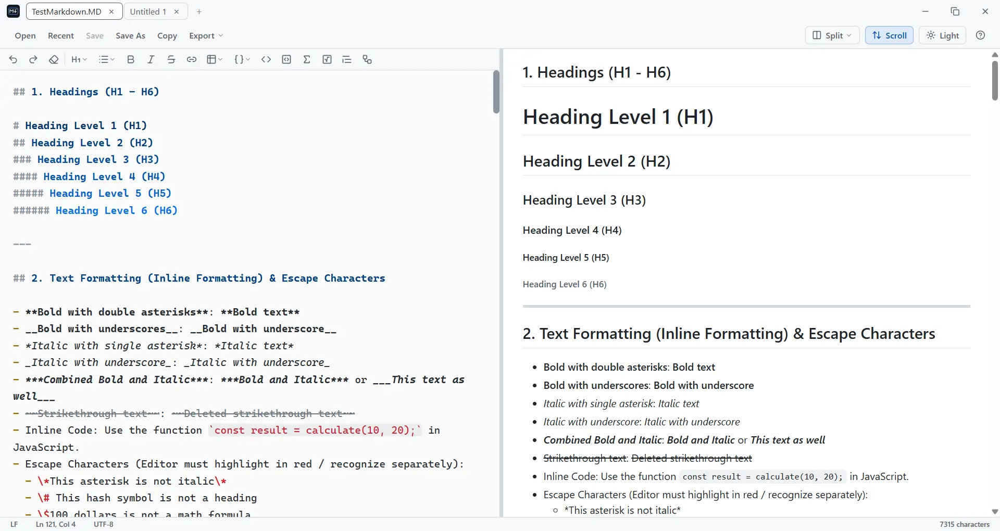
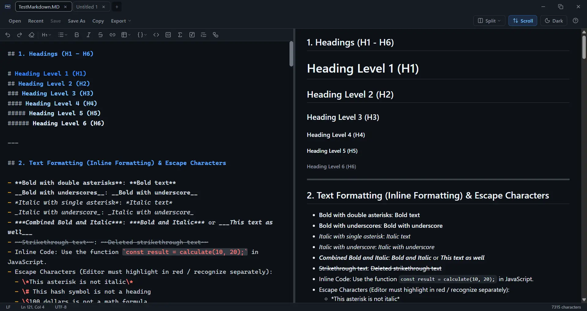

<div align="center">


# Markdown Live

Trình soạn thảo Markdown hai chiều thời gian thực hoạt động độc lập, ngoại tuyến (Offline-first) được đóng gói trên nền tảng Tauri v2.

[](https://tauri.app/)

[](https://developer.mozilla.org/)
[](https://github.com/uytran0610/markdown-live-app/releases)
[](LICENSE)

</div>

<div align="center">

[English](README.md) | **Tiếng Việt**

</div>

---

## Mục lục

- [Tính năng kỹ thuật](#tính-năng-kỹ-thuật)
- [Ảnh chụp màn hình](#ảnh-chụp-màn-hình)
- [Bắt đầu nhanh](#bắt-đầu-nhanh)
- [Cách sử dụng](#cách-sử-dụng)
- [Giới hạn & lưu ý khi mở file](#giới-hạn--lưu-ý-khi-mở-file)
- [Hướng dẫn xuất file](#hướng-dẫn-xuất-file)
- [Tổng quan kiến trúc](#tổng-quan-kiến-trúc)
- [Công nghệ sử dụng](#công-nghệ-sử-dụng)
- [Cấu trúc dự án](#cấu-trúc-dự-án)
- [Đóng góp](#đóng-góp)
- [Quyền riêng tư](#quyền-riêng-tư)
- [Giấy phép](#giấy-phép)

---

## Tính năng kỹ thuật

- **Đồng bộ hai chiều & ba chế độ xem:** Soạn thảo song song với bản xem trước tự cập nhật ngay sau khi bạn ngừng gõ, và cuộn một khung thì khung còn lại cuộn theo. Chuyển tức thì giữa **Editor**, **Split** và **Preview**, hoặc kéo thanh chia để tùy chỉnh độ rộng hai khung.
- **Render phong phú, hoạt động hoàn toàn ngoại tuyến:** GitHub Markdown Alerts, công thức KaTeX (nội dòng và dạng khối), sơ đồ Mermaid và tô màu cú pháp Highlight.js, tất cả đều xử lý cục bộ.
- **Bộ công cụ soạn thảo đầy đủ:** Thanh công cụ định dạng (tiêu đề, danh sách, in đậm/nghiêng, bảng, liên kết, code, công thức, Mermaid), tô màu cú pháp Markdown trực tiếp và đếm ký tự thời gian thực.
- **Xuất đa định dạng:** HTML độc lập (`.html`), Word (`.doc`, sơ đồ Mermaid chuyển thành ảnh) hoặc PDF vector (giữ khả năng chọn/copy văn bản).
- **Tab & an toàn dữ liệu:** Mở nhiều file thành nhiều tab, hỗ trợ kéo để đổi thứ tự, ghim tab và menu chuột phải. Bản nháp, thứ tự tab và chế độ xem gần nhất được tự động lưu và khôi phục ở lần mở tiếp theo, còn file bị chương trình khác sửa sẽ được phát hiện trước khi có thể bị ghi đè.
- **Tìm & thay thế:** Panel tìm kiếm nổi ở góc trên bên phải vùng nội dung, hỗ trợ phân biệt hoa thường, biểu thức chính quy, Replace / Replace All và tham chiếu nhóm `$1`…`$9`.
- **Chủ đề Sáng/Tối:** Tự động nhận diện theme hệ thống, cho phép chuyển đổi thủ công và ghi nhớ giữa các phiên.

---

## Ảnh chụp màn hình

<div align="center">



<sub><b>Giao diện Sáng (Light)</b>: rõ ràng, tương phản tốt, phù hợp làm việc ban ngày và xuất tài liệu</sub>

<br />



<sub><b>Giao diện Tối (Dark)</b>: dịu mắt khi thiếu sáng, tự theo theme hệ thống hoặc chuyển đổi thủ công</sub>

</div>

---

## Bắt đầu nhanh

### Tải bản dựng sẵn (khuyến nghị cho người dùng)

Bản thực thi portable cho Windows (`.exe`) được build tự động qua GitHub Actions mỗi khi có tag phát hành mới. Tải bản mới nhất tại trang **[Releases](https://github.com/uytran0610/markdown-live-app/releases)**. Không cần cài đặt gì thêm, chỉ cần chạy file `Markdown-Live-Portable.exe`.

Mỗi bản phát hành còn có hai bộ cài đặt cho người dùng thích quy trình cài đặt thông thường: `Markdown-Live-Setup.exe` (NSIS) và `Markdown-Live-Setup.msi`. Bộ cài đặt đăng ký `.md`, `.markdown`, `.mdown`, `.mkd` và `.txt` với Windows, nên nhấp đúp file Markdown sẽ mở bằng Markdown Live.

> [!WARNING]
> **Windows SmartScreen có thể chặn ứng dụng khi mở lần đầu**
>
> Vì đây là ứng dụng mã nguồn mở, miễn phí và **chưa được ký chứng chỉ số** (loại chứng chỉ code-signing trả phí hàng năm), Windows Defender SmartScreen có thể hiển thị cảnh báo **"Windows protected your PC"** khi bạn chạy file lần đầu, với dòng **Publisher: Unknown publisher**. Đây là cảnh báo mặc định áp dụng cho mọi ứng dụng chưa ký số, không đồng nghĩa file chứa mã độc. Bạn có thể chọn **một trong hai** cách dưới đây để tiếp tục chạy ứng dụng.

**Bỏ qua cảnh báo SmartScreen**

1. Trong hộp thoại **"Windows protected your PC"**, nếu chưa thấy nút **Run anyway**, nhấp vào **More info** (Thông tin thêm) để hiện nút này ra.
2. Nhấn **Run anyway** (Vẫn chạy) để mở ứng dụng bình thường.

**Gỡ thuộc tính chặn của file (Nếu nhấp đúp không mở ứng dụng)**

1. Nhấp chuột phải vào file `Markdown-Live-Portable.exe` → chọn **Properties**.
2. Ở tab **General**, cuộn xuống cuối cùng, mục **Security**. Nếu thấy dòng chữ: *"This file came from another computer and might be blocked to help protect this computer."*
3. Tích chọn ô **Unblock** → nhấn **Apply** → **OK**.
4. Nhấp đúp mở lại file `.exe`, ứng dụng sẽ khởi động bình thường.

> [!NOTE]
> Nếu muốn kiểm tra file trước khi chạy, bạn có thể quét bằng phần mềm diệt virus đang dùng, hoặc tải file lên [VirusTotal](https://www.virustotal.com/) để đối chiếu kết quả từ nhiều engine bảo mật khác nhau.

### Chạy từ mã nguồn (dành cho lập trình viên)

**Yêu cầu hệ thống:**
- [Node.js](https://nodejs.org/) phiên bản 20 trở lên
- [Rust toolchain](https://www.rust-lang.org/tools/install) (bản ổn định mới nhất)
- Các thư viện phụ thuộc hệ thống của Tauri v2 theo hướng dẫn tại [Tauri Prerequisites](https://tauri.app/start/prerequisites/)

**Các bước thực hiện:**

```bash
# 1. Clone repository
git clone https://github.com/uytran0610/markdown-live-app.git
cd markdown-live-app

# 2. Cài đặt dependencies
npm install

# 3. Chạy ở chế độ phát triển (dev, hot-reload)
npm run tauri dev

# 4. Build bản phát hành (installer NSIS/MSI)
npm run tauri build
```

---

## Cách sử dụng

Sau khi mở ứng dụng, gõ hoặc dán nội dung Markdown vào khung **EDITOR** bên trái, kết quả sẽ được render ở khung **PREVIEW** bên phải ngay khi bạn gõ. Thanh công cụ phía trên cung cấp các thao tác nhanh:

| Nút | Chức năng |
| :--- | :--- |
| **Open** | Mở một hoặc nhiều file Markdown từ máy. Mỗi file mở thành một tab riêng, và file đã mở sẽ được chuyển tới thay vì mở trùng (`Ctrl`/`Cmd` + `O`) |
| **Recent** | Menu các file vừa mở, cuối danh sách có **Clear Recent Files** (chỉ hiện sau khi bạn đã mở ít nhất một file) |
| **Save** | Ghi nội dung tab hiện tại về lại file trên ổ đĩa, hoặc hỏi vị trí lưu nếu tab chưa có file. Nút bị vô hiệu cho tới khi tab có thay đổi chưa lưu (`Ctrl`/`Cmd` + `S`) |
| **Save As** | Lưu tab hiện tại thành file mới hoặc ở vị trí mới (`Ctrl`/`Cmd` + `Shift` + `S`) |
| **Save All** | Lưu toàn bộ tab đang có thay đổi chưa lưu, lần lượt từng tab (`Ctrl`/`Cmd` + `Alt` + `S`); chỉ hiện khi có từ hai tab đang thay đổi trở lên |
| **Copy** | Sao chép toàn bộ nội dung Markdown của tab hiện tại vào clipboard |
| **Export** | Mở menu xuất nội dung ra **HTML** (`.html`), **Word** (`.doc`, sơ đồ Mermaid được chuyển thành ảnh) hoặc **Print** (`.pdf`, qua hộp thoại in của hệ thống, chọn được văn bản) |
| **View** | Chuyển đổi giữa chế độ **Editor**, **Split** và **Preview** |
| **Scroll** | Bật/tắt đồng bộ cuộn trang giữa Editor và Preview (mặc định bật) |
| **Theme** | Chuyển đổi giao diện Sáng / Tối |
| **About** | Mở hộp thoại giới thiệu gồm phiên bản ứng dụng, License, Privacy Statement và Third-party Notices (nút tròn `?` ở cuối thanh công cụ) |

### Chế độ xem & chia màn hình

- **Editor:** soạn thảo toàn màn hình, không hiển thị bản xem trước.
- **Split:** Editor và Preview hiển thị song song (mặc định).
- **Preview:** chỉ hiển thị kết quả render, toàn màn hình.

Ở chế độ **Split**, kéo thanh chia dọc giữa hai khung để thay đổi độ rộng tùy ý. Kéo sát về một bên sẽ tự động chuyển sang chế độ **Editor** hoặc **Preview**. Ứng dụng ghi nhớ chế độ xem gần nhất giữa các lần mở, nhưng độ rộng khung không được lưu và luôn mở lại ở tỉ lệ 50/50.

### Thanh công cụ định dạng

Thanh công cụ định dạng nằm phía trên khung **EDITOR**. Bôi đen đoạn văn bản rồi nhấn nút để áp dụng định dạng, hoặc nhấn nút khi không bôi đen để chèn cú pháp Markdown tại vị trí con trỏ.

| Nút | Chức năng | Kết quả Markdown | Phím tắt |
| :--- | :--- | :--- | :--- |
| **Undo** / **Redo** | Lùi lại hoặc làm lại lịch sử chỉnh sửa | Không có | `Ctrl`/`Cmd` + `Z` / `Ctrl`/`Cmd` + `Y` |
| **Clear** | Xóa ngay toàn bộ nội dung khung soạn thảo, không hỏi xác nhận. Nhấn `Ctrl`/`Cmd` + `Z` để khôi phục | Không có | Không có |
| **Headings** | Chọn cấp tiêu đề từ danh sách, hoặc **Plain text** để bỏ dấu `#` của tiêu đề | `# Heading 1` ... `###### Heading 6` | Không có |
| **Lists** | Chọn loại danh sách: gạch đầu dòng, đánh số hoặc task list | `- item`, `1. item`, `- [ ] task` | Không có |
| **B** (Bold) | In đậm đoạn văn bản đang chọn | `**text**` | `Ctrl`/`Cmd` + `B` |
| *I* (Italic) | In nghiêng đoạn văn bản đang chọn | `*text*` | `Ctrl`/`Cmd` + `I` |
| ~~S~~ (Strikethrough) | Gạch ngang giữa đoạn văn bản đang chọn | `~~text~~` | `Ctrl`/`Cmd` + `Shift` + `X` |
| **Link** | Mở hộp thoại nhập văn bản hiển thị và URL, sau đó chèn liên kết | `[text](url)` | Không có |
| **Table** | Chọn kích thước bằng lưới trực quan 5×5, hoặc chọn **Custom size** cho bảng lớn hơn | `\| Column \| Column \|` | Không có |
| **HTML Inline** | Bọc đoạn chọn bằng Superscript, Subscript, `<kbd>` (phím bàn phím) hoặc `<mark>` (highlight) | `<sup>`, `<sub>`, `<kbd>`, `<mark>` | Không có |
| **Inline Code** | Bọc đoạn chọn thành code nội dòng | `` `code` `` | `Ctrl`/`Cmd` + `E` |
| **Code Block** | Chèn khối mã nguồn (fenced code block) | ` ```js ... ``` ` | Không có |
| **Inline Math** | Bọc đoạn chọn thành công thức LaTeX nội dòng | `$E = mc^2$` | Không có |
| **Math Block** | Chèn khối công thức LaTeX dạng hiển thị | `$$ ... $$` | Không có |
| **Blockquote** | Biến (các) dòng hiện tại thành trích dẫn | `> text` | Không có |
| **Mermaid Diagram** | Chèn mẫu khởi tạo sơ đồ Mermaid | ` ```mermaid ... ``` ` | Không có |
| **Find** | Mở panel tìm & thay thế nổi | Không có | `Ctrl`/`Cmd` + `F` |

> [!TIP]
> Mọi thao tác trên thanh công cụ đều hoạt động với Undo/Redo (`Ctrl`/`Cmd` + `Z` / `Ctrl`/`Cmd` + `Y`), và bản xem trước tự cập nhật sau mỗi thao tác.
>
> Nút **Link** trên thanh công cụ mở hộp thoại để nhập văn bản và URL, trong khi phím tắt `Ctrl`/`Cmd` + `K` chèn nhanh `[link](url)` ngay tại vị trí con trỏ với `url` được bôi đen sẵn để dán. Dùng cách nào tiện hơn tùy bạn.

### Tìm & thay thế

Tìm kiếm và thay thế ngay trong tài liệu hiện tại, không cần rời khung soạn thảo:

- **Mở:** nhấn `Ctrl`/`Cmd` + `F`, hoặc bấm nút kính lúp ở cuối thanh công cụ định dạng. Hàng **Replace** mặc định đang gập; nhấn `Ctrl`/`Cmd` + `H` để mở panel kèm hàng này.
- **Tìm:** gõ từ khoá, rồi dùng **▲** / **▼** (hoặc `Enter` / `Shift` + `Enter`) để chuyển giữa các kết quả. Bộ đếm hiện vị trí kết quả hiện tại và tổng số kết quả.
- **Tuỳ chọn:** **Aa** phân biệt hoa thường, còn **`.*`** coi từ khoá là biểu thức chính quy. Ở chế độ biểu thức chính quy, ô thay thế nhận `$1`…`$9`, `$&` (toàn bộ kết quả khớp), `$'` (phần chữ trước kết quả khớp) và `$$` (ký tự `$` thật).
- **Thay thế:** **Replace** chỉ thay kết quả hiện tại, còn **Replace All** thay tất cả kết quả cùng lúc.
- **Tô sáng:** phần chữ khớp được tô sáng thẳng trong editor để bạn thấy panel đang trỏ tới đâu. Tối đa 500 kết quả được tô màu cùng lúc, và việc tìm kiếm dừng ở 5.000 kết quả.

> [!NOTE]
> Panel chỉ quét nội dung editor, không quét DOM của khung Preview. Mở panel không đổi chế độ xem của bạn, nhưng nếu đang ở chế độ chỉ **Preview**, bấm chuyển tới một kết quả sẽ tạm hiện khung **Editor**.

### Phím tắt trong Editor

Khung soạn thảo hỗ trợ sẵn các phím tắt định dạng và chỉnh sửa quen thuộc như trong các trình soạn thảo mã nguồn:

| Phím tắt | Chức năng |
| :--- | :--- |
| `Ctrl`/`Cmd` + `F` | Mở panel tìm & thay thế |
| `Ctrl`/`Cmd` + `H` | Mở panel tìm & thay thế kèm hàng **Replace** |
| `Ctrl`/`Cmd` + `B` | In đậm đoạn văn bản đang chọn |
| `Ctrl`/`Cmd` + `I` | In nghiêng đoạn văn bản đang chọn |
| `Ctrl`/`Cmd` + `Shift` + `X` | Gạch ngang giữa chữ (Strikethrough) |
| `Ctrl`/`Cmd` + `E` | Bọc đoạn chọn thành code inline |
| `Ctrl`/`Cmd` + `K` | Chèn liên kết, tự động bôi đen phần `url` để dán nhanh |
| `Ctrl`/`Cmd` + `D` | Nhân bản dòng hiện tại (hoặc vùng đang chọn) |
| `Ctrl`/`Cmd` + `Z` | Hoàn tác (Undo) |
| `Ctrl`/`Cmd` + `Y` | Làm lại (Redo) (`Cmd` + `Shift` + `Z` trên macOS, `Ctrl` + `Shift` + `Z` trên Linux) |
| `Tab` / `Shift` + `Tab` | Thụt lề / hủy thụt lề. Dùng được cả khi bôi đen nhiều dòng; không có vùng chọn thì `Tab` chèn 4 khoảng trắng |
| `Enter` | Tự động giữ thụt lề, tiếp tục danh sách (`-`, `1.`, `>`, task list) hoặc thoát danh sách nếu dòng đang trống |
| Gõ `(`, `[`, `{`, nháy đơn/kép, backtick, `*`, `_`, `~` hoặc `$` khi đang bôi đen | Tự động bao đoạn đang chọn bằng đúng ký hiệu vừa gõ |
| Gõ `(`, `[`, `{` hoặc nháy đơn/kép khi không bôi đen | Tự động chèn ký tự đóng khi ký tự ngay sau con trỏ cho phép, và không bao giờ đóng ngay trước một chữ cái hoặc chữ số. Gõ lại ký tự đóng đó sẽ nhảy qua nó, còn nhấn `Backspace` khi cặp đang rỗng sẽ xoá cả cặp. Nháy đơn gõ ngay sau chữ cái hoặc chữ số (như `don't`) được coi là dấu lược nên không tự đóng |

### Làm việc với Tab

- **Đổi thứ tự:** kéo tab sang trái hoặc phải. Chấm trên tab nghĩa là tab đó có thay đổi chưa lưu.
- **Đóng tab:** bấm dấu `×`, bấm chuột giữa vào tab hoặc nhấn `Ctrl`/`Cmd` + `W`. Đóng tab có thay đổi chưa lưu sẽ hỏi có lưu trước hay không.
- **Menu chuột phải:** Save, Save As, Close, Close Others, Close to the Right, Close Saved Tabs, Pin / Unpin Tab, Copy Path và Reveal in Explorer. Các tab đã ghim sẽ bị bỏ qua bởi các lệnh đóng hàng loạt.
- **Nhiều tab:** khi dải tab tràn, cuộn bằng con lăn chuột hoặc nút ‹ ›, và bấm chuột phải vào nút › để xem danh sách toàn bộ tab đang mở.
- **Thanh trạng thái:** hiện dòng và cột của con trỏ, kiểu xuống dòng (bấm để chuyển giữa LF và CRLF), mã hoá file và số ký tự.

### Phím tắt Tab & File

Các phím tắt sau hoạt động ở mọi chế độ, kể cả **Preview**:

| Phím tắt | Chức năng |
| :--- | :--- |
| `Ctrl`/`Cmd` + `O` | Mở file |
| `Ctrl`/`Cmd` + `S` | Lưu tab hiện tại xuống đĩa (hỏi vị trí lưu nếu tab chưa có file) |
| `Ctrl`/`Cmd` + `Shift` + `S` | Lưu thành file mới (Save As): lưu tab hiện tại thành tên hoặc vị trí khác |
| `Ctrl`/`Cmd` + `Alt` + `S` | Lưu tất cả (Save All): lưu mọi tab đang có thay đổi chưa lưu |
| `Ctrl`/`Cmd` + `T` | Tab mới |
| `Ctrl`/`Cmd` + `Shift` + `T` | Mở lại tab vừa đóng |
| `Ctrl`/`Cmd` + `W` | Đóng tab hiện tại |
| `Ctrl`/`Cmd` + `Tab` / `Ctrl`/`Cmd` + `Shift` + `Tab` | Chuyển sang tab kế tiếp / tab trước |
| `Ctrl`/`Cmd` + `PageDown` / `Ctrl`/`Cmd` + `PageUp` | Chuyển sang tab kế tiếp / tab trước |
| `Ctrl`/`Cmd` + `1`...`9` | Nhảy tới tab theo vị trí |
| `←` / `→`, `Home` / `End` (khi dải tab đang được focus) | Chuyển sang tab trước / sau / đầu / cuối; `Delete` đóng tab đang focus |

---

## Giới hạn & lưu ý khi mở file

- **Cách mở file:** nút **Open** (`Ctrl`/`Cmd` + `O`), menu **Recent**, kéo-thả file vào cửa sổ, hoặc nhấp đúp file trong Windows (bộ cài đăng ký sẵn `.md`, `.markdown`, `.mdown`, `.mkd` và `.txt`). Ứng dụng chỉ chạy một cửa sổ, nên mở thêm file khi app đang chạy sẽ đưa file đó vào cửa sổ hiện có dưới dạng tab mới.
- **File được hỗ trợ:** `.md`, `.markdown`, `.mdown`, `.mkd`, `.mdx`, `.rmd`, `.qmd`, `.txt`, `.text`, hoặc file không có đuôi (như `README`). Các loại khác (ảnh, file thực thi, …) sẽ bị từ chối.
- **Dung lượng:** không giới hạn dung lượng mỗi file, file cỡ nào cũng mở được và gõ được. File trên 1.000.000 ký tự sẽ hiện thông báo "quá lớn để xem trước" ở khung preview, còn nguồn file vẫn đọc và sửa đầy đủ ở chế độ Editor. File nhỏ hơn được render theo từng khối: KaTeX, Mermaid và tô màu cú pháp chỉ chạy khi khối lọt vào vùng nhìn thấy, và sau lượt phân tích đầu chỉ khối nào bạn sửa mới được render lại. Session giữ bản nháp của tab tới 16 MB mỗi tab. Tab file-backed lớn hơn được đọc lại từ đĩa khi mở lại app, còn tab Untitled khổng lồ chưa lưu sẽ không được khôi phục.
- **Mã hoá:** mọi lần lưu đều ghi UTF-8. File lưu ở UTF-16 (ví dụ "Unicode" của Notepad) hoặc mã cũ của Windows (Windows-1252/1258) sẽ được nhận diện, chuyển sang UTF-8 trong bộ nhớ rồi mới mở, và ứng dụng sẽ báo rằng file đã được chuyển mã và sẽ được lưu lại thành UTF-8. BOM UTF-8 và kiểu xuống dòng (LF/CRLF) của file được ghi nhớ và giữ nguyên khi lưu; bấm **LF**/**CRLF** trên thanh trạng thái để đổi. File không phải văn bản (file nhị phân) bị từ chối thay vì mở ra lỗi chữ.
- **Thư mục:** bản này được cấu hình để đọc/ghi trong các thư mục Home, Documents, Desktop và Downloads (kể cả thư mục con). File ở nơi khác có thể bị từ chối. Ứng dụng sẽ báo rõ, và **Save As** cho phép chọn vị trí khác.
- **Mỗi file một tab:** file đã mở sẽ được chuyển tới thay vì mở thêm lần nữa.
- **Thay đổi từ bên ngoài ứng dụng:** khi cửa sổ được focus lại (hoặc khi bạn chuyển sang một tab), ứng dụng kiểm tra file trên đĩa. Tab không có thay đổi chưa lưu sẽ tự tải lại, còn tab đang có thay đổi chưa lưu sẽ hỏi **Keep my version** (giữ bản của bạn) hay **Load from disk** (tải từ đĩa). Nếu file đã bị xóa, tab hiện dấu `!` và việc lưu sẽ đi qua **Save As**.

---

## Hướng dẫn xuất file

### PDF

> [!TIP]
> **Chuyển sang giao diện Sáng trước khi xuất.**
> Để có kết quả tốt nhất, hãy dùng giao diện **Sáng (Light)** trước khi xuất PDF để bản in có màu sắc rõ ràng và độ tương phản tốt trên giấy.

> [!IMPORTANT]
> **Cấu hình Print Engine của hệ thống:**
> Để bản in hoặc file xuất PDF giữ nguyên toàn bộ nền màu, định dạng Alert Callouts và khối mã nguồn:
> 1. Trong hộp thoại in của hệ thống (Print Dialog), mở rộng danh mục **More settings (Cài đặt khác)**.
> 2. Bật tùy chọn **Background graphics (Đồ họa nền)**.

### DOC

> [!TIP]
> **Chuyển sang giao diện Sáng trước khi xuất.**
> Để có kết quả tốt nhất, hãy dùng giao diện **Sáng (Light)** trước khi xuất DOC để tài liệu Word giữ được màu sắc rõ ràng và độ tương phản tốt.

File `.doc` sau khi xuất có thể mở bằng Microsoft Word. Các sơ đồ Mermaid được tự động chuyển thành ảnh.

---

## Tổng quan kiến trúc

Markdown Live được thiết kế với mục tiêu tối ưu hiệu năng bộ nhớ và tốc độ phản hồi. Ứng dụng sử dụng kiến trúc hybrid:
- **Core Runtime:** Tauri v2 (Rust backend) đảm bảo kích thước binary nhỏ gọn, quản lý clipboard native và API hệ thống với mức tiêu hao tài nguyên thấp. Plugin single-instance giữ một cửa sổ duy nhất và chuyển các file mở sau đó vào đó dưới dạng tab mới.
- **Frontend Layer:** Hoàn toàn bằng Vanilla JavaScript/HTML5/CSS3. Không sử dụng Single Page Application (SPA) framework nặng nề, toàn bộ dependencies thư viện được lưu trữ cục bộ (`vendor/`), không phụ thuộc mạng CDN ngoài.
- **Editor Engine:** CodeMirror 6, được bundle thủ công vào `src/vendor/codemirror.bundle.js`. Mọi tab dùng chung một `EditorView`, và mỗi tab giữ `EditorState` riêng nên lịch sử undo không trộn giữa các tab.
- **Preview Pipeline:** Markdown được parse thành từng khối, băm (hash) và cache lại, nên sau lượt phân tích đầu chỉ khối bạn sửa mới được render lại. KaTeX, Mermaid và tô màu cú pháp chạy lazy khi khối lọt vào vùng nhìn thấy.
- **Session Storage:** Bản nháp, thứ tự tab và đường dẫn file đang mở nằm trong IndexedDB, nên phiên làm việc vẫn còn sau khi khởi động lại, kể cả với tài liệu lớn.

> [!NOTE]
> Ứng dụng chạy hoàn toàn offline. Mọi quá trình parse Markdown, biên dịch công thức Toán học KaTeX và vẽ biểu đồ Mermaid đều được thực thi trực tiếp tại Webview client-side.

---

## Công nghệ sử dụng

| Phân hệ | Công nghệ / Thư viện | Vai trò |
| :--- | :--- | :--- |
| **Backend Core** | Tauri v2, Rust | Quản trị cửa sổ, Clipboard Manager, Opener, Dialog & FS Plugins, Single-instance (chỉ một cửa sổ chạy, file mở sau được chuyển vào cửa sổ đó), Snap Layout (khung snap của Windows 11 trên nút Maximize tự vẽ) |
| **Editor Engine** | CodeMirror 6 | Soạn thảo Markdown, tô màu cú pháp trực tiếp, undo/redo, tự đóng ngoặc (bundle thủ công vào `src/vendor/codemirror.bundle.js`) |
| **Markdown Parser**| Marked.js + DOMPurify | Phân tích cú pháp Markdown và lọc XSS an toàn |
| **Mathematics** | KaTeX + extension Marked tự viết (render lazy) | Xử lý công thức Toán học TeX/LaTeX, chỉ render khi khối lọt vào vùng nhìn thấy |
| **Diagram Engine** | Mermaid.js | Render biểu đồ từ cú pháp khai báo |
| **Code Engine** | Highlight.js | Tô màu cú pháp khối mã lệnh |
| **Preview Styling** | github-markdown-css | Kiểu chữ giống GitHub cho khung Preview (sáng + tối) |
| **Iconography** | Lucide Icons | Hệ thống icon giao diện người dùng |

---

## Cấu trúc dự án

```
markdown-live-app/
├── src/                        # Frontend (HTML/CSS/JS thuần)
│   ├── index.html              # Vỏ ứng dụng: nạp vendor scripts + js/main.js
│   ├── assets/                 # Ảnh tĩnh (icon ứng dụng)
│   ├── css/                    # Các file style, nạp theo thứ tự cascade
│   │   ├── tokens.css          # Biến màu cho theme Sáng / Tối
│   │   ├── base.css
│   │   ├── layout.css
│   │   ├── format-bar.css
│   │   ├── dialogs.css
│   │   ├── toast.css
│   │   ├── toolbar.css
│   │   ├── tabs.css
│   │   ├── editor.css
│   │   ├── preview.css
│   │   └── print.css
│   ├── js/                     # Module ES, nhóm theo trách nhiệm
│   │   ├── main.js             # Điểm vào app: khởi tạo các module theo thứ tự
│   │   ├── core/               # Tham chiếu DOM, toast, hàm dùng chung
│   │   ├── editor/             # Bọc CodeMirror 6 (cm.js), panel tìm & thay thế,
│   │   │                       # thao tác định dạng, phím tắt toàn cục
│   │   ├── preview/            # Render theo khối + cache hash, sanitize, liên kết
│   │   ├── export/             # Pipeline xuất .html / .doc / .pdf
│   │   ├── io/                 # Lưu trữ tab & tài liệu, session trong IndexedDB
│   │   ├── ui/                 # Thanh định dạng, hộp thoại, tab, đồng bộ cuộn, chế độ xem
│   │   ├── theme/              # Theme Sáng / Tối
│   │   └── dev/                # Tự kiểm tra (?selfcheck) + đo hiệu năng (?perf)
│   ├── vendor/                 # Thư viện bên thứ 3 lưu cục bộ (marked, katex,
│   │   └── fonts/              # mermaid, codemirror.bundle.js...) + font web KaTeX
│   ├── PRIVACY.md              # Tuyên bố quyền riêng tư hiển thị trong hộp thoại About
│   ├── THIRD_PARTY_NOTICES.md  # Giấy phép của các thư viện trong vendor/
│   └── LICENSE                 # Giấy phép MIT cho frontend
├── src-tauri/                  # Backend Rust + cấu hình Tauri
│   ├── src/
│   │   ├── lib.rs
│   │   └── main.rs
│   ├── capabilities/           # Quyền plugin (dialog, fs, opener...)
│   ├── icons/
│   ├── build.rs
│   ├── Cargo.toml
│   └── tauri.conf.json
├── scripts/
│   ├── sync-version.js         # Đồng bộ version + cache-busting tài nguyên
│   ├── vendor-update.js        # Làm mới src/vendor/ (node scripts/vendor-update.js)
│   └── vendor/
│       └── codemirror.entry.js # Điểm vào để build gói CM6 thủ công
├── images/                     # Ảnh chụp màn hình cho README
├── icon.png
├── README.vi.md
└── .github/workflows/          # CI/CD build & release (release.yml)
```

---

## Đóng góp

Mọi đóng góp đều được hoan nghênh! Nếu bạn muốn cải thiện dự án:

1. Fork repository và tạo nhánh mới (`git checkout -b feature/ten-tinh-nang`).
2. Thực hiện thay đổi và commit rõ ràng, dễ hiểu.
3. Đảm bảo `npm run tauri dev` chạy ổn định trước khi gửi Pull Request.
4. Mở Pull Request kèm mô tả ngắn gọn về thay đổi.

Nếu phát hiện lỗi hoặc có đề xuất tính năng, vui lòng tạo [Issue](https://github.com/uytran0610/markdown-live-app/issues) mới.

---

## Quyền riêng tư

Markdown Live lưu mọi thứ trên thiết bị của bạn, không tài khoản, không analytics, không telemetry. Xem đầy đủ [Tuyên bố Quyền riêng tư](src/PRIVACY.md).

---

## Giấy phép

Phát hành dưới giấy phép [MIT](LICENSE).